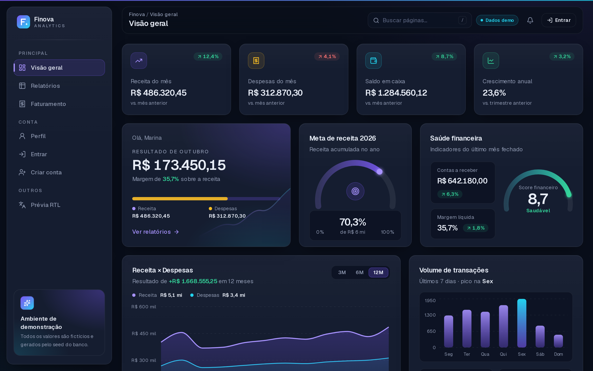
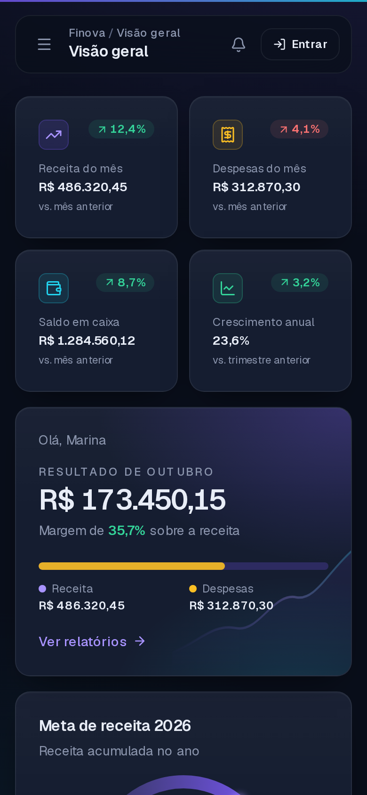

# Finova Analytics

Painel financeiro em dark mode: receitas, despesas, fluxo de caixa, metas e orçamentos, com animações e navegação fluida. Começou a partir do template Vision UI e foi redesenhado e remodelado como um SaaS financeiro brasileiro.

> **Ambiente de demonstração.** Todos os nomes, valores e e-mails são fictícios (domínio reservado `.example`) e vêm do seed do banco.





## Stack

| Camada | Escolha |
|---|---|
| Framework | Next.js 16 (App Router, Turbopack) |
| Linguagem | TypeScript |
| Estado | Redux Toolkit + RTK Query |
| Estilo | Tailwind CSS v4 (tokens em `@theme`, container queries) |
| Animação | Framer Motion (layout, entrada, contagem) + Recharts (desenho dos gráficos) |
| Gráficos | Recharts (área, barras) e gauges SVG próprios |
| Banco | SQLite via Prisma (adapter libSQL: o mesmo client funciona local ou com Turso) |
| Testes | Playwright (smoke E2E em 3 viewports) |
| Fonte e ícones | Geist (`next/font`), lucide-react |

## Rodando localmente

Requisitos: Node.js 20+ e npm.

```bash
npm install
npm run db:reset   # recria prisma/dev.db a partir do schema e roda o seed (apaga os dados locais)
npm run dev        # http://localhost:3000
```

`/` redireciona para `/dashboard`. O login é simulado: qualquer e-mail válido e senha com 6+ caracteres funcionam.

## Testes

```bash
npm run ci:local          # mesmos gates do CI: lint, tipos, unitários, auditoria e E2E
npm run lint
npm run typecheck
npm run test:unit         # testes unitários (node:test, ~130 ms)
npm run test:e2e          # build de produção + 51 cenários (7 rotas × 3 viewports + fluxos)
npm run test:e2e:report   # abre o relatório HTML do último run
```

A suíte (`e2e/smoke.spec.ts`) verifica:

- as 7 rotas sem erro no console e sem overflow horizontal em 1440, 768 e 390 px;
- KPIs em BRL;
- o filtro de período do gráfico e o tooltip em BRL;
- a navegação pela sidebar (desktop) e pelo drawer (tablet/celular);
- a busca de páginas (`/` + Enter);
- a direção RTL, o login e o erro de validação em PT-BR;
- o modo de movimento reduzido.

## Documentação

A documentação viva fica em [`docs/`](docs/README.md): [PRD inicial](docs/produto/prd-inicial.md), [decisões (ADRs)](docs/decisoes/README.md), [histórico da fase 1](docs/historico/2026-11-15-fase-1.md), [relatório de QA](docs/qualidade/relatorio-qa-fase-1.md), [deploy](docs/operacao/deploy.md) e [roteiro de demo](docs/apresentacao/roteiro-demo.md). Versões no [CHANGELOG](CHANGELOG.md).

## Decisões de engenharia

**Dinheiro em centavos (inteiros).** Nenhum valor monetário fica no banco como `float` ou string formatada. Colunas com sufixo `Cents` guardam inteiros, e métricas mistas usam `value Int` + `format`: `currency` são centavos, `percent` são pontos-base (1% = 100) e `number` são unidades. A formatação acontece só na interface, em `src/lib/format.ts`, com `Intl` pt-BR.

> Pegadinha documentada: o `Intl` em pt-BR insere um **espaço não separável** (U+00A0) entre `R$` e o número. Nos testes, use `/R\$\s/`.

**Tokens únicos de design.** As cores, sombras e easing ficam em `@theme` (`src/app/globals.css`). O Recharts e o SVG não leem classes Tailwind, então recebem os mesmos valores de `src/lib/tokens.ts`.

**Animação com propósito.** As transições de interface ficam entre 200 e 400 ms. O desenho dos gráficos leva 700 ms só na primeira montagem e 300 ms nas trocas de período. Com `prefers-reduced-motion`, tudo é congelado: o `MotionConfig` cobre o Framer, o `useReducedMotion` cobre o Recharts e uma media query cobre o CSS.

**Widgets isolados.** Cada card lê o próprio hook RTK Query e tem skeleton e estado de erro com "Tentar novamente". Uma rota que falha não derruba o painel.

**Container queries.** O tamanho dos valores dos KPIs acompanha a largura do card, não a da viewport, e não trunca de 320 a 1920 px.

## API

Rotas em `src/app/api/*/route.ts`, com envelope `{ data }` ou `{ error: { message } }`. Os nomes das rotas e dos modelos vieram do template original. A tabela mostra o significado financeiro de cada um:

| Rota | Modelo | Exibido como |
|---|---|---|
| `GET /api/stats` | `StatCard` | KPIs: Receita, Despesas, Saldo, Crescimento |
| `GET /api/sales-overview` | `SalesPoint` | Receita × Despesas (12 meses, em centavos) |
| `GET /api/active-users` | `ActiveUsersPoint` / `ActiveUsersStat` | Volume de transações + indicadores operacionais |
| `GET /api/satisfaction` | `SatisfactionRate` | Meta anual de receita (% atingido) |
| `GET /api/referral` | `ReferralSummary` / `ScoreRing` | Saúde financeira (contas a receber, margem, score) |
| `GET /api/projects` | `Project` | Orçamentos por área |
| `GET /api/orders` | `OrderEvent` | Transações recentes (valor com sinal) |
| `GET /api/authors` | `Author` | Equipe financeira |
| `GET /api/invoices` | `Invoice` | Faturas da assinatura |
| `POST /api/auth/sign-in` · `sign-up` | — | Login e cadastro simulados, com validação |

Todas as rotas GET têm uma latência artificial de 350 a 750 ms (`simulateLatency`) para que os skeletons fiquem visíveis na demonstração.

## CI/CD

Todo PR e todo push na `main` passam pelos gates **Qualidade** (lint, tipos e testes unitários), **Segurança** (gitleaks e `npm audit`) e **E2E** (Playwright). Só então o deploy na Vercel acontece: preview no PR, produção na `main`, com smoke test. Guia e configuração dos secrets: [docs/operacao/ci-cd.md](docs/operacao/ci-cd.md).

## Deploy (Vercel + Turso)

O SQLite local não persiste no serverless. Com `TURSO_DATABASE_URL` e `TURSO_AUTH_TOKEN` definidos, o adapter libSQL aponta para o Turso sem mudar código.

**Atenção:** o schema mudou (valores em centavos). Um banco Turso criado com a versão anterior precisa ser recriado e repopulado (passo a passo em [docs/operacao/deploy.md](docs/operacao/deploy.md)). A operação é destrutiva e só deve ser feita num banco de demonstração:

```bash
TURSO_DATABASE_URL="<url>" TURSO_AUTH_TOKEN="<token>" npm run db:reset
```

## Estrutura

```
prisma/            schema.prisma (convenções de valores no topo) · seed.ts (dados demo coerentes)
e2e/               smoke.spec.ts (Playwright)
src/
  app/(app)/       dashboard · tables · billing · profile · rtl  (shell com sidebar + navbar)
  app/(auth)/      sign-in · sign-up
  app/api/         rotas REST
  components/
    brand/         logo Finova
    dashboard/     cards do painel (KPI, resumo, meta, saúde, gráficos, orçamentos, transações)
    layout/        Sidebar, Navbar, PageSearch
    ui/            Card, CardHeader, ErrorState, Skeleton, DeltaBadge, AnimatedNumber, ChartTooltip, SegmentedControl…
  lib/             format.ts · tokens.ts · tones.ts · icon-map.tsx · prisma.ts
  store/           RTK Query + slices (ui, auth)
```

## Limitações conhecidas e próximos passos

- A autenticação é simulada: não há sessão nem hash de senha.
- Os nomes dos modelos e das rotas são herdados do template. O próximo passo seria renomeá-los (`SatisfactionRate` → `RevenueGoal` etc.) junto com a API.
- Os KPIs são linhas pré-calculadas no seed. Em produção, seriam agregados calculados a partir das transações.
- `Int` no Prisma tem 32 bits, ou seja, até cerca de R$ 21 milhões em centavos. Para escala real, a migração seria para `BigInt`.
- Os botões "PDF" e "Novo cartão" ficam desabilitados de propósito na demo.
- O E2E roda só em Chromium. Safari e Firefox não foram testados.
