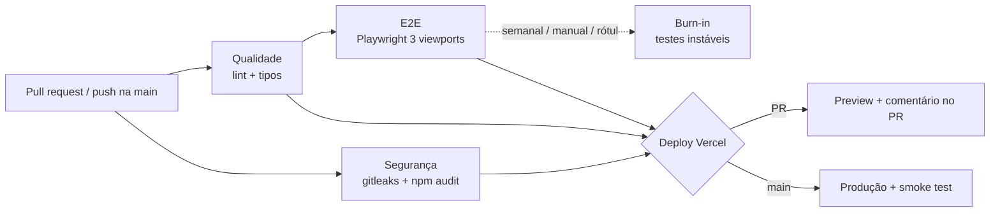

# Operação: pipeline de CI/CD

Arquivo: [`.github/workflows/ci.yml`](../../.github/workflows/ci.yml) · Decisão: [ADR-0007](../decisoes/0007-pipeline-ci-cd.md)

## Fluxo



## Gates

| Job | O que verifica | Bloqueia o deploy? |
|---|---|---|
| **Qualidade** | `npm run lint` + `npm run typecheck` | Sim |
| **Segurança** | Segredos no histórico (gitleaks) e `npm audit` das dependências de produção | Sim, para segredo ou vulnerabilidade **crítica**. Altas viram aviso no resumo do job |
| **E2E** | 51 cenários Playwright em 1440/768/390 px contra o build de produção, com o banco recriado pelo seed | Sim |
| **Burn-in** | A suíte repetida 5× sem retries, para expor testes instáveis | Não (roda à parte) |
| **Deploy** | Preview em PR; produção em push na `main`; smoke test em `/api/stats` e `/dashboard` | — |

### Quando cada job roda

| Evento | Qualidade | Segurança | E2E | Burn-in | Deploy |
|---|---|---|---|---|---|
| PR para `main` | ✓ | ✓ | ✓ | só com o rótulo `burn-in` | preview |
| Push na `main` | ✓ | ✓ | ✓ | — | produção |
| Segunda, 06:00 (Brasília) | ✓ | ✓ | ✓ | ✓ | — |
| Manual (*Run workflow*) | ✓ | ✓ | ✓ | opcional | — |

## Boas práticas aplicadas

- **Actions fixadas por SHA de commit**, com a versão em comentário. Isso protege contra tag reescrita (supply chain), e o Dependabot atualiza os SHAs.
- **Permissões mínimas:** o padrão é `contents: read`. Só o deploy escreve, e apenas comentários de PR.
- **`persist-credentials: false`** no checkout: o token não fica gravado no `.git` do runner.
- **Concorrência:** em PR, uma execução nova cancela a anterior. Na `main`, as execuções entram em fila e um deploy nunca é interrompido.
- **Timeouts por job** e **cache** de dependências npm e dos navegadores do Playwright.
- **Reprodutibilidade:** Node fixado por `.nvmrc`, `npm ci` com lockfile, CLI da Vercel com versão fixa.
- **Deploy só depois dos gates** (`needs`), com smoke test pós-deploy em produção.
- **Artefatos só em falha** (relatório HTML e traces do Playwright), com retenção de 14 dias.
- **Sem segredo em código:** credenciais vêm de *secrets* e *variables* do GitHub.
- **Dependabot** semanal para npm e Actions, com minor e patch agrupados e majors em PRs individuais.

## Configuração (uma vez)

### 1. Vercel

1. Crie o projeto na Vercel **sem** conectar o repositório pelo Git. O deploy é feito pelo CI, e o `vercel.json` desliga o deploy automático da integração Git para evitar deploy duplicado sem gates.
2. Na raiz do projeto, rode `npx vercel link`. Isso gera `.vercel/project.json` com `orgId` e `projectId`. A pasta `.vercel` já está no `.gitignore`.
3. Gere um token em **vercel.com → Account Settings → Tokens**.
4. No projeto da Vercel, em **Settings → Environment Variables**, defina `TURSO_DATABASE_URL` e `TURSO_AUTH_TOKEN` para *Production* e *Preview* (veja [deploy.md](deploy.md)).

### 2. GitHub (secrets e variables)

```bash
gh secret   set VERCEL_TOKEN      --repo alvaro5801/finova-analytics   # cola o token quando pedir
gh variable set VERCEL_ORG_ID     --repo alvaro5801/finova-analytics --body "<orgId>"
gh variable set VERCEL_PROJECT_ID --repo alvaro5801/finova-analytics --body "<projectId>"
```

Sem essas três, o job de deploy **não falha**. Ele termina com um aviso "Deploy ignorado", e os gates continuam valendo.

### Checklist de secrets e variáveis

| Nome | Tipo | Onde | Para quê |
|---|---|---|---|
| `VERCEL_TOKEN` | secret | GitHub | Autenticar a CLI da Vercel |
| `VERCEL_ORG_ID` | variable | GitHub | Identificar o time ou conta na Vercel |
| `VERCEL_PROJECT_ID` | variable | GitHub | Identificar o projeto na Vercel |
| `TURSO_DATABASE_URL` | env | Vercel | Banco de produção e preview |
| `TURSO_AUTH_TOKEN` | env | Vercel | Autenticação no Turso |
| `GITHUB_TOKEN` | automático | GitHub | Gitleaks e comentário de preview |

## Limitações do plano atual (repositório privado, GitHub Free)

| Recurso | Situação | Quando liberar |
|---|---|---|
| Branch protection / rulesets exigindo os checks | Indisponível em repositório privado no Free | Repositório público ou GitHub Pro. Exija os checks **Qualidade**, **Segurança** e **E2E** |
| *Environments* com aprovação manual para produção | Indisponível em repositório privado no Free | Idem. Adicione `environment: production` ao job de deploy |
| CodeQL e Dependency Review | Exigem GitHub Advanced Security em repositório privado | Repositório público: grátis |
| Minutos de Actions | 2.000 por mês | Por isso o burn-in usa 5 iterações e não roda em todo PR |

Enquanto não houver branch protection, a regra é: **trabalhar em branch e abrir PR**. O PR mostra os gates e o preview antes do merge.

## Rodando localmente

```bash
npm run ci:local                      # lint, tipos, auditoria e E2E (mesmos gates do CI)
ITERATIONS=10 bash scripts/burn-in.sh # burn-in completo (padrão TEA: 10 iterações)
```

## Diagnóstico

| Sintoma | Causa provável | Ação |
|---|---|---|
| Aviso "Deploy ignorado" | Faltam `VERCEL_TOKEN`, `VERCEL_ORG_ID` ou `VERCEL_PROJECT_ID` | Seção "Configuração" |
| Smoke test falhou em `/api/stats` | Banco Turso sem o schema atual ou variáveis ausentes na Vercel | `npm run db:reset` contra o Turso ([deploy.md](deploy.md)) |
| E2E falhou | Regressão ou teste instável | Baixe o artefato `playwright-report-*` e rode `npx playwright show-trace` |
| Segurança falhou no `npm audit` | Vulnerabilidade crítica em dependência de produção | Atualize a dependência; se não houver correção, registre a exceção num ADR |
| Resumo da Segurança mostra 3 altas no Prisma | Vulnerabilidade conhecida e aceita na CLI do Prisma 6 | Esperado até a migração ([ADR-0008](../decisoes/0008-adiar-migracao-prisma-7.md)) |
| Segurança falhou no gitleaks | Segredo no histórico | **Revogue o segredo primeiro** e depois limpe o histórico |
