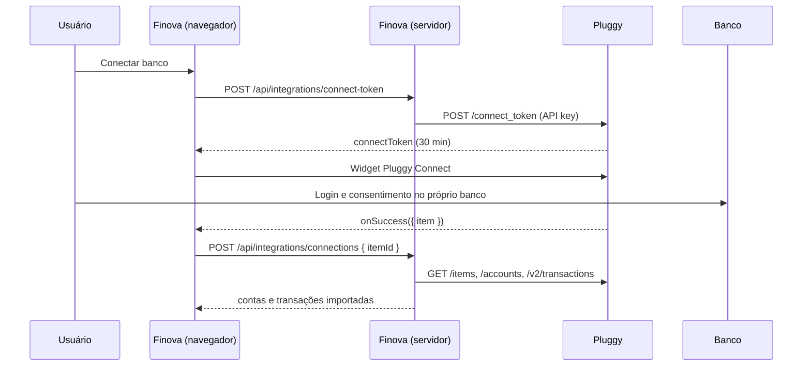

# Operação: integração bancária (Open Finance)

Página: `/integrations` · Código: [`src/lib/banking/`](../../src/lib/banking) e [`src/app/api/integrations/`](../../src/app/api/integrations)

O Finova lê contas, saldos e transações dos bancos do usuário por meio de um **agregador de Open Finance** (Pluggy). O acesso é **somente de leitura**: nenhum dinheiro passa pelo Finova.

## Como funciona



- O Finova guarda só o `itemId`, nunca senha ou credencial do banco.
- `CLIENT_ID`/`CLIENT_SECRET` ficam só no servidor. A API key dura 2 h e é renovada automaticamente.
- Desconectar chama `DELETE /items/{id}`, que revoga o consentimento na Pluggy, e apaga a conexão, as contas e as transações locais.

## Modos

| Modo | Quando | O que acontece |
|---|---|---|
| **Demonstração** (padrão) | Sem as variáveis abaixo | Bancos fictícios e histórico gerado de forma determinística ([`demo-data.ts`](../../src/lib/banking/demo-data.ts)). A tela de consentimento simula o banco. Funciona offline. |
| **Pluggy** | `BANKING_PROVIDER=pluggy` + chaves | Mesmas rotas e telas, falando com `https://api.pluggy.ai` ([`pluggy-provider.ts`](../../src/lib/banking/pluggy-provider.ts)). |

`npm run db:reset` apaga todas as conexões, inclusive as criadas durante uma demonstração.

## Ativar a Pluggy

1. Crie a conta de desenvolvedor em [dashboard.pluggy.ai](https://dashboard.pluggy.ai). Contas novas já têm acesso ao **sandbox**: banco "Pluggy Bank", usuário `user-ok`, senha `password-ok`, MFA `123456`.
2. Configure em `.env.local` (ignorado pelo git) e nos segredos da hospedagem:
   ```bash
   BANKING_PROVIDER=pluggy
   PLUGGY_CLIENT_ID=...
   PLUGGY_CLIENT_SECRET=...
   PLUGGY_WEBHOOK_SECRET=<valor aleatório longo>
   PLUGGY_SANDBOX=true   # mostra o "Pluggy Bank" no widget; remover em produção
   ```
3. **Widget:** já integrado (`react-pluggy-connect`, carregado só no navegador). No sandbox, escolha **Sandbox → Fluxo básico** no widget e entre com `user-ok` / `password-ok`. O nome exibido no topo do widget ("Demo usa a Pluggy…") é o nome do app no painel da Pluggy.
4. **Webhook:** cadastre uma vez com `POST /webhooks` na Pluggy, informando `url: https://<domínio>/api/integrations/webhook`, `event: "all"` e `headers: { "x-finova-webhook-secret": "<PLUGGY_WEBHOOK_SECRET>" }`. A Pluggy não assina as chamadas; o cabeçalho secreto é a autenticação, e a rota responde 401 sem ele. Não use o `webhookUrl` por Item, porque ele não envia cabeçalhos.

## Regras de dados

- **Valores:** centavos com sinal do Finova (positivo = entrada). Conta: o sinal da Pluggy é usado como vem.
- **Cartão:** a documentação diz "compra = positivo", mas o sandbox manda compra **negativa**, e o `type` vem `CREDIT` nos dois casos. Por isso [`normalizeCardAmount`](../../src/lib/banking/normalize.ts) descobre a convenção pelo sinal predominante (compras são a maioria). O pagamento da fatura (categoria `05100000`) é sempre entrada.
- **Categorias:** chegam em inglês; traduzimos pelo `categoryId` com `GET /categories` (`descriptionTranslated`), com cache de 24 h.
- **Testes E2E:** o Playwright força `BANKING_PROVIDER=demo`, então a suíte não depende da Pluggy nem de rede.
- **Sincronização:** a primeira importa até 1 ano. As seguintes substituem a janela desde a última sincronização menos 7 dias, cobrindo transações pendentes que mudaram.
- **Status:** `UPDATED` → conectado · `UPDATING` → sincronizando · `LOGIN_ERROR`/`WAITING_USER_INPUT` ou consentimento revogado → precisa reconectar · demais → erro.

## Antes de produção

- **Login real:** hoje o dono da conexão é fixo (`currentUserId()` em [`sync.ts`](../../src/lib/banking/sync.ts)). Com autenticação real, use o id da sessão: é isso que isola os dados de cada pessoa.
- **LGPD e sigilo bancário:** publique o aviso de privacidade (o que é coletado, para quê, por quanto tempo) e mantenha a exclusão ao desconectar.
- **Custo e cobertura:** confira o plano da Pluggy e a [lista de instituições](https://docs.pluggy.ai/docs/open-finance-institutions-coverage). A cobertura não inclui todos os bancos do país.
